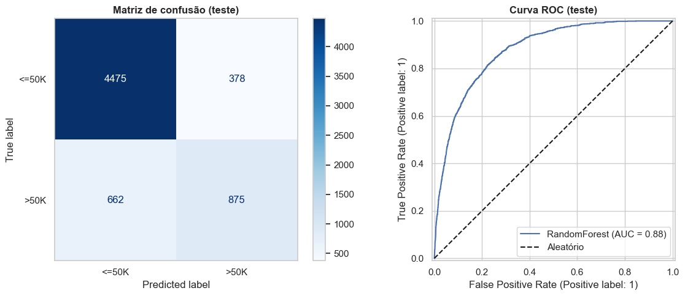

# 2. Avaliação do melhor modelo no conjunto de teste

Agora usamos o conjunto de teste, **uma única vez**, com o modelo final escolhido apenas por validação cruzada. O `GridSearchCV`/`RandomizedSearchCV` já reajustou (`refit=True`) o melhor pipeline em todo o treino.

??? example "Ver código"

    ```python
    y_pred = modelo_final.predict(X_test_proc)
    y_proba = modelo_final.predict_proba(X_test_proc)[:, 1]

    print(classification_report(y_te, y_pred, target_names=["<=50K", ">50K"], digits=3))
    print("ROC-AUC:", round(roc_auc_score(y_te, y_proba), 4))
    ```


```text
precision    recall  f1-score   support

       <=50K      0.871     0.922     0.896      4853
        >50K      0.698     0.569     0.627      1537

    accuracy                          0.837      6390
   macro avg      0.785     0.746     0.762      6390
weighted avg      0.830     0.837     0.831      6390

ROC-AUC: 0.8779
```

??? example "Ver código"

    ```python
    fig, axes = plt.subplots(1, 2, figsize=(12, 5))

    ConfusionMatrixDisplay.from_predictions(
        y_te, y_pred, display_labels=["<=50K", ">50K"], cmap="Blues", ax=axes[0]
    )
    axes[0].set_title("Matriz de confusão (teste)", fontweight="bold")
    axes[0].grid(False)

    RocCurveDisplay.from_predictions(y_te, y_proba, ax=axes[1], name=melhor_nome)
    axes[1].plot([0, 1], [0, 1], "k--", label="Aleatório")
    axes[1].set_title("Curva ROC (teste)", fontweight="bold")
    axes[1].legend()

    plt.tight_layout()
    plt.show()

    tn, fp, fn, tp = pd.crosstab(y_te, y_pred).values.ravel()
    print(f"Verdadeiros negativos: {tn} | Falsos positivos: {fp} | Falsos negativos: {fn} | Verdadeiros positivos: {tp}")
    ```





```text
Verdadeiros negativos: 4475 | Falsos positivos: 378 | Falsos negativos: 662 | Verdadeiros positivos: 875
```

**Avaliação do Random Forest v2:**

1. **Métricas de Desempenho Reportadas:**
    - **Accuracy geral:** 0,837 (83,7%)
    - **Métricas da classe positiva (`>50K`):**
        - **Precision:** 0,698 (69,8%)
        - **Recall:** 0,569 (56,9%)
        - **F1-score:** 0,627
    - **ROC-AUC:** 0,8779 (~0,88)

2. **Consistência entre Validação Cruzada e Teste (Generalização):**
    - O $F_1$-score obtido no conjunto de teste ($0{,}627$) é altamente compatível com a média observada durante a validação cruzada do Pipeline v2 ($F_1 = 0{,}6262$).
    - Essa aderência confirma que o ajuste de hiperparâmetros e a seleção do pipeline não causaram overfitting nem vazamento de dados (*data leakage*), demonstrando que o modelo possui uma capacidade sólida e consistente de generalização para dados inéditos.

3. **Análise da Matriz de Confusão e Tipos de Erro:**
    - **Falsos Positivos ($FP = 378$):** Ocorrem quando o modelo prevê erroneamente que a pessoa ganha `>50K`, mas na realidade ela tem renda `<=50K` (falsos alarmes de alta renda).
    - **Falsos Negativos ($FN = 662$):** Ocorrem quando o modelo deixa de identificar uma pessoa de alta renda, classificando-a incorretamente como `<=50K`.
    - **Tipo de erro predominante:** Os falsos negativos foram consideravelmente mais frequentes que os falsos positivos ($662$ vs. $378$). Isso reflete o comportamento conservador do modelo com o limiar padrão de 0,5, priorizando a precisão (acertar cerca de 7 a cada 10 predições positivas) em detrimento de capturar todos os casos reais da classe minoritária.

4. **Impacto do Desbalanceamento e Interpretação do ROC-AUC:**
    - Devido ao desbalanceamento das classes (~76% `<=50K` e ~24% `>50K`), o modelo tende a ser mais cauteloso ao predizer a classe minoritária, resultando em um *recall* sensivelmente menor para `>50K` ($56{,}9\%$) em relação à classe majoritária ($92{,}2\%$).
    - Contudo, o **ROC-AUC de 0,8779** atesta uma excelente capacidade discriminativa global. Como a métrica é independente do corte rígido de probabilidade de 0,5, ela evidencia que, em cerca de 87,8% das vezes, o modelo atribui uma probabilidade de renda alta maior a um indivíduo que de fato ganha `>50K` em comparação a um que ganha `<=50K`. Se a aplicação de negócio exigisse a captura de um número maior de indivíduos de alta renda, bastaria calibrar o limiar de decisão (*threshold tuning*) para um valor inferior a 0,5, reduzindo os falsos negativos.
