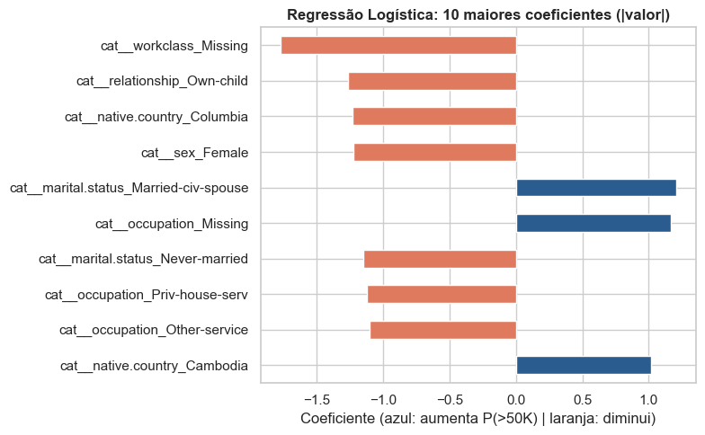
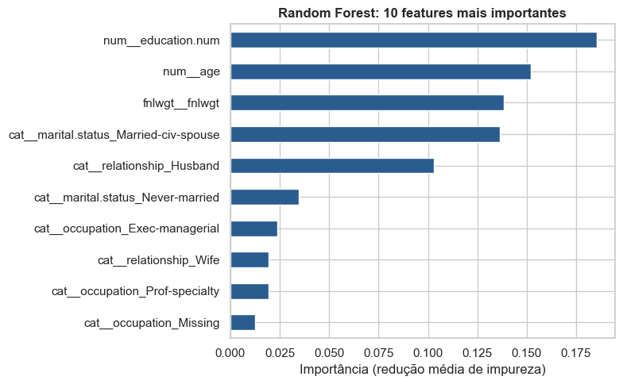
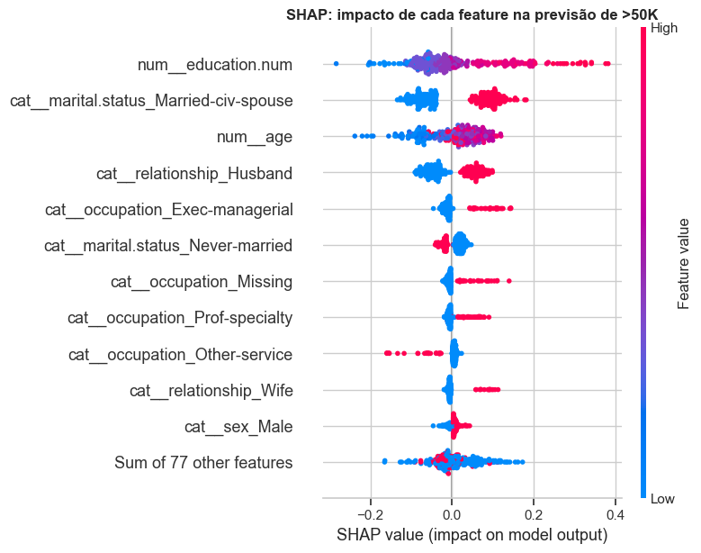
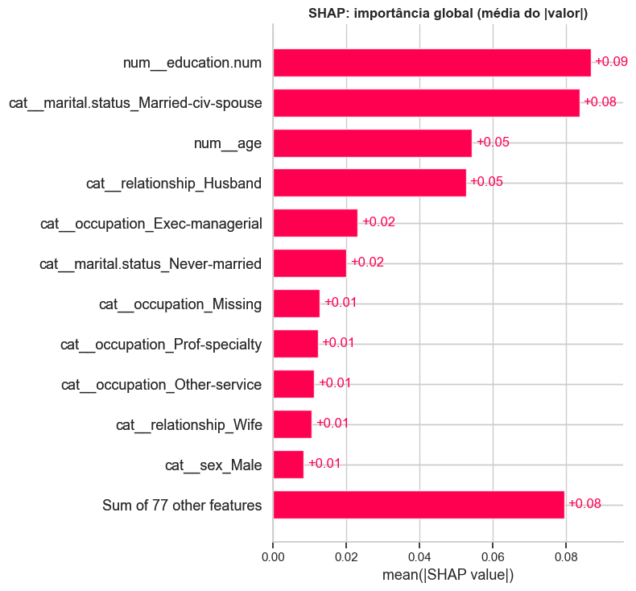
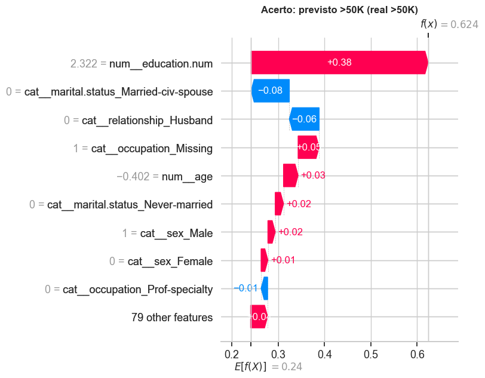
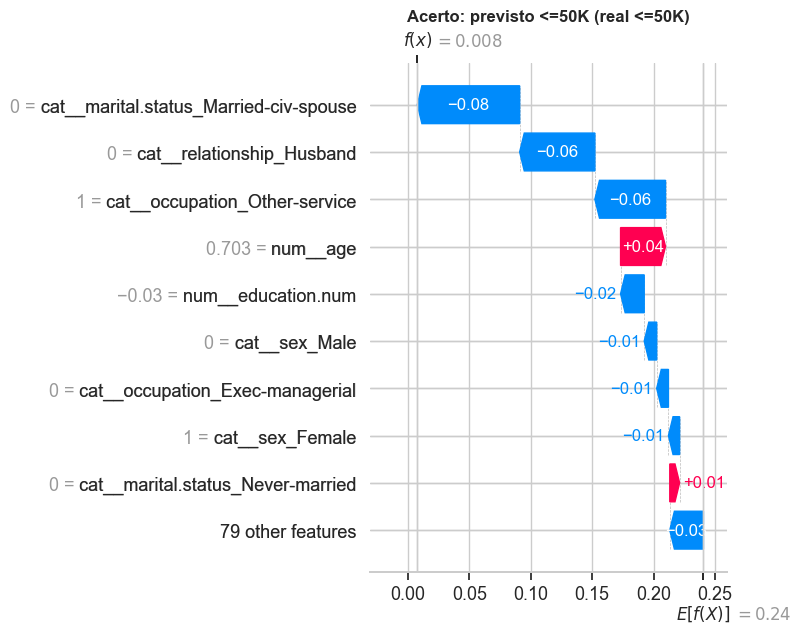
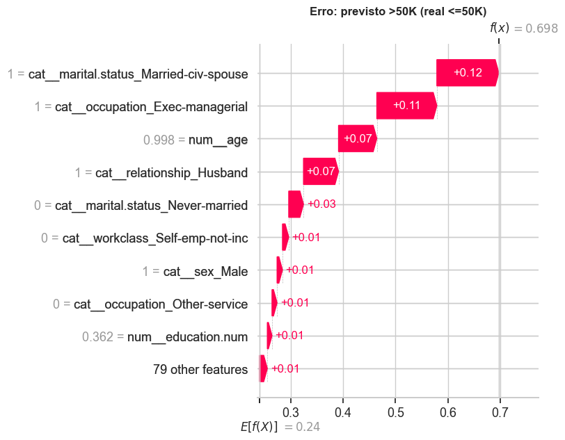

# 3. Interpretação e explicabilidade

## 3.1 Modelo linear: 3 maiores coeficientes

Usamos a Regressão Logística otimizada da Seção 1.2. Coeficiente positivo → aumenta a chance de `>50K`; negativo → diminui. **Ressalva:** as variáveis numéricas estão padronizadas e as categóricas são dummies 0/1, então a comparação direta de magnitudes é aproximada.

??? example "Ver código"

    ```python
    lr_est = gs_lr.best_estimator_
    nomes_lr = lr_est.named_steps["prep"].get_feature_names_out()
    coefs = pd.Series(lr_est.named_steps["model"].coef_[0], index=nomes_lr)
    top_coef = coefs.reindex(coefs.abs().sort_values(ascending=False).index)

    display(top_coef.head(10).rename("coeficiente").to_frame())

    plt.figure(figsize=(8, 5))
    top_coef.head(10)[::-1].plot(kind="barh", color=["#2b5c8f" if v > 0 else "#e07a5f" for v in top_coef.head(10)[::-1]])
    plt.title("Regressão Logística: 10 maiores coeficientes (|valor|)", fontweight="bold")
    plt.xlabel("Coeficiente (azul: aumenta P(>50K) | laranja: diminui)")
    plt.tight_layout()
    plt.show()
    ```


|                                        | coeficiente   |
|:---------------------------------------|:--------------|
| cat__workclass_Missing                 | -1.7752       |
| cat__relationship_Own-child            | -1.2661       |
| cat__native.country_Columbia           | -1.2353       |
| cat__sex_Female                        | -1.2248       |
| cat__marital.status_Married-civ-spouse | 1.2076        |
| cat__occupation_Missing                | 1.1653        |
| cat__marital.status_Never-married      | -1.1536       |
| cat__occupation_Priv-house-serv        | -1.1260       |
| cat__occupation_Other-service          | -1.1055       |
| cat__native.country_Cambodia           | 1.0168        |





??? example "Ver código"

    ```python
    # Diagnóstico da coluna occupation: "?" e o valor-lixo "occupation" viram NaN juntos. São grupos diferentes?
    tipo_occ = X_train["occupation"].where(X_train["occupation"].isin(["?", "occupation"]), "valor válido")
    tab = pd.crosstab(tipo_occ, y_tr, normalize="index").round(3)
    tab.columns = ["P(<=50K)", "P(>50K)"]
    tab["n"] = tipo_occ.value_counts()
    display(tab)
    ```


|              | P(<=50K)   | P(>50K)   | n     |
|:-------------|:-----------|:----------|:------|
| ?            | 0.8980     | 0.1020    | 1432  |
| occupation   | 0.4610     | 0.5390    | 1188  |
| valor válido | 0.7660     | 0.2340    | 22937 |


**3.1 Análise das 3 features de maior |coeficiente| (Regressão Logística, L2, C = 1)**

Coeficiente positivo aumenta o log-odds de `>50K`; negativo o diminui. As três de maior magnitude:

1. **`workclass_Missing` (β = −1,775):** ausência de classe de trabalho reduz fortemente a chance de `>50K`. Coerente com a APS1: os registros `"?"` em `workclass` (1.778) tendem a ser pessoas fora do emprego formal, onde renda alta é rara.
2. **`relationship_Own-child` (β = −1,266):** filhos que vivem com os pais concentram jovens em início de carreira ou estudantes (a idade mínima da base é 17), grupo com pouquíssimos casos de renda alta. O sinal é coerente com a EDA.
3. **`native.country_Columbia` (β = −1,235):** esta é a feature menos confiável do ranking. Na APS1 vimos que há só 59 registros da Colômbia, quase todos `<=50K`; o coeficiente grande reflete **amostra pequena** (dummy rara pouco encolhida pela regularização), não um efeito real da nacionalidade, e deve ser lido como associação, não causa.

**Ressalvas importantes:**

- As dummies não estão na mesma escala das numéricas padronizadas, então comparar magnitudes é aproximado.
- `occupation_Missing` tem sinal **positivo** (+1,165), oposto ao de `workclass_Missing`. Isso sugere colinearidade: os dois "Missing" se sobrepõem em parte e o modelo linear divide o efeito entre eles; além disso, `occupation = NaN` mistura dois grupos (valores `"?"` e o valor-lixo `"occupation"`), como mostra a tabela acima. O efeito líquido de "ocupação ausente" não deve ser lido isoladamente.
- `sex_Female` (β = −1,225) é o 4º maior coeficiente: o modelo linear aprendeu a desigualdade de gênero presente nos dados, ponto retomado na Seção 4.

## 3.2 Modelo ensemble: 3 features de maior importância

Usamos a Random Forest otimizada da Seção 1.2 (`feature_importances_`, baseada na redução média de impureza).

??? example "Ver código"

    ```python
    rf_est = rs_rf.best_estimator_
    nomes_rf = rf_est.named_steps["prep"].get_feature_names_out()
    imp = pd.Series(rf_est.named_steps["model"].feature_importances_, index=nomes_rf).sort_values(ascending=False)

    display(imp.head(10).rename("importância").to_frame())

    plt.figure(figsize=(8, 5))
    imp.head(10)[::-1].plot(kind="barh", color="#2b5c8f")
    plt.title("Random Forest: 10 features mais importantes", fontweight="bold")
    plt.xlabel("Importância (redução média de impureza)")
    plt.tight_layout()
    plt.show()
    ```


|                                        | importância   |
|:---------------------------------------|:--------------|
| num__education.num                     | 0.1854        |
| num__age                               | 0.1520        |
| fnlwgt__fnlwgt                         | 0.1383        |
| cat__marital.status_Married-civ-spouse | 0.1365        |
| cat__relationship_Husband              | 0.1028        |
| cat__marital.status_Never-married      | 0.0345        |
| cat__occupation_Exec-managerial        | 0.0237        |
| cat__relationship_Wife                 | 0.0195        |
| cat__occupation_Prof-specialty         | 0.0192        |
| cat__occupation_Missing                | 0.0124        |





**3.2 Análise das 3 features de maior importância (Random Forest v1, impureza/MDI)**

Esta análise usa a RF otimizada da Seção 1.2 (v1, que ainda contém `fnlwgt`), o que permite discutir o efeito dessa variável.

1. **`education.num` (0,185):** anos de estudo são o principal divisor: níveis superiores concentram a renda `>50K` e níveis baixos a evitam.
2. **`age` (0,152):** a chance de `>50K` é baixa em jovens, cresce até a meia-idade (≈ 35–55 anos, pela EDA) e cai perto da aposentadoria. As árvores capturam essa relação não linear com vários cortes.
3. **`fnlwgt` (0,138):** aparece em 3º lugar, mas **a importância é espúria**. É um peso amostral sem sentido causal, e removê-lo não alterou o F1 (Seção 1.3). O MDI favorece variáveis contínuas com muitos valores distintos (Strobl et al., 2007), pois elas oferecem muitos pontos de corte que "reduzem impureza" no treino. A primeira feature genuinamente informativa depois de `age` é `marital.status_Married-civ-spouse` (0,136), seguida de `relationship_Husband` (0,103).

A análise SHAP do modelo final (v2), na Seção 3.3, confirma que, sem `fnlwgt`, a hierarquia passa a ser `education.num`, `Married-civ-spouse` e `age`.

## 3.3 SHAP no melhor modelo

SHAP atribui a cada feature uma contribuição (em valor de SHAP) para cada predição, com base em valores de Shapley da teoria dos jogos. Há duas leituras: **global** (importância média das features no conjunto) e **local** (por que *esta* pessoa foi classificada assim). Usamos uma amostra de 300 linhas do teste para manter o tempo de execução razoável. O explicador é escolhido conforme o modelo final (`TreeExplainer` para árvores, `LinearExplainer` para a logística).

??? example "Ver código"

    ```python
    prep_f = modelo_final.named_steps["prep"]
    clf_f = modelo_final.named_steps["model"]
    nomes_f = prep_f.get_feature_names_out()

    def to_dense(M):
        return M.toarray() if hasattr(M, "toarray") else np.asarray(M)

    # Amostra do teste (já transformada pelo pré-processador do modelo final)
    rng = np.random.RandomState(RANDOM_STATE)
    pos = rng.choice(len(X_test_proc), size=300, replace=False)
    X_s = pd.DataFrame(to_dense(prep_f.transform(X_test_proc.iloc[pos])), columns=nomes_f)
    y_s = y_te.values[pos]
    pred_s = clf_f.predict(X_s.values)

    if isinstance(clf_f, LogisticRegression):
        fundo = pd.DataFrame(to_dense(prep_f.transform(X_train_proc.sample(500, random_state=RANDOM_STATE))), columns=nomes_f)
        explainer = shap.LinearExplainer(clf_f, fundo)
        sv = explainer(X_s)
    else:
        explainer = shap.TreeExplainer(clf_f)
        sv = explainer(X_s)
        if sv.values.ndim == 3:          # classificadores de árvore retornam 1 mapa por classe
            sv = sv[:, :, 1]             # usamos a classe positiva (>50K)

    print("Explicações calculadas:", sv.values.shape)
    ```


```text
Explicações calculadas: (300, 88)
```

??? example "Ver código"

    ```python
    # Importância global: valores de SHAP em todas as amostras
    shap.plots.beeswarm(sv, max_display=12, show=False)
    plt.title("SHAP: impacto de cada feature na previsão de >50K", fontweight="bold")
    plt.tight_layout()
    plt.show()

    shap.plots.bar(sv, max_display=12, show=False)
    plt.title("SHAP: importância global (média do |valor|)", fontweight="bold")
    plt.tight_layout()
    plt.show()
    ```








**3.3 Análise global com SHAP (Random Forest v2, 300 casos de teste)**

SHAP (Lundberg & Lee, 2017) decompõe cada predição em contribuições por feature. Valor à direita de zero aumenta a probabilidade prevista de `>50K`; à esquerda, diminui. Nas dummies, vermelho = categoria presente.

**Importância global (média do |SHAP|):**

1. **`education.num` (0,09):** mais anos de estudo empurram para `>50K`; poucos anos, para `<=50K`.
2. **`marital.status_Married-civ-spouse` (0,08):** casado no civil (vermelho) desloca a predição para `>50K`; não casado, para `<=50K`.
3. **`age` (0,05):** efeito não linear: jovens (azul) têm contribuição negativa; idades intermediárias e mais altas, positiva.
4. **`relationship_Husband` (0,05):** complementa o estado civil.
5. **`Exec-managerial` e `Never-married` (0,02):** ocupação executiva aumenta a chance; nunca ter casado reduz.

**Pontos de atenção:**

- `occupation_Missing` tem efeito **positivo** (vermelho à direita), contraintuitivo à primeira vista. Como `occupation = NaN` agrupa o valor-lixo `"occupation"` e os `"?"`, o sinal reflete a composição desses grupos, não "não informar ocupação" em si; o SHAP é fiel ao modelo, e o modelo é fiel a um dado com problema de qualidade (Seção 4.2).
- O ranking é parcialmente consistente com 3.1: ambos destacam estado civil e relações familiares. Mas a LogReg dá grande peso a categorias raras (`Columbia`, β ≈ −1,2), ausentes do top do SHAP, onde o impacto é ponderado pela frequência. Para o ranking de MDI (3.2), o SHAP remove o artefato do `fnlwgt` e coloca `Married-civ-spouse` à frente de `age`.
- `sex_Male` aparece entre as 12 maiores (≈ 0,01): impacto pequeno, mas não nulo, relevante para a discussão de equidade.

??? example "Ver código"

    ```python
    # Três casos individuais variados: um acerto de >50K, um acerto de <=50K e um erro
    idx_tp = np.where((y_s == 1) & (pred_s == 1))[0][0]
    idx_tn = np.where((y_s == 0) & (pred_s == 0))[0][0]
    idx_err = np.where(y_s != pred_s)[0][0]

    casos = {"Acerto: previsto >50K (real >50K)": idx_tp,
             "Acerto: previsto <=50K (real <=50K)": idx_tn,
             f"Erro: previsto {'>50K' if pred_s[idx_err] else '<=50K'} (real {'>50K' if y_s[idx_err] else '<=50K'})": idx_err}

    for titulo, i in casos.items():
        print("=" * 70)
        print(titulo)
        print(X_test_proc.iloc[pos[i]][["age", "workclass", "education.num", "marital.status", "occupation", "sex"]].to_dict())
        shap.plots.waterfall(sv[i], max_display=10, show=False)
        plt.title(titulo, fontweight="bold")
        plt.tight_layout()
        plt.show()
    ```


```text
======================================================================
Acerto: previsto >50K (real >50K)
{'age': 33, 'workclass': 'Private', 'education.num': 16, 'marital.status': 'Divorced', 'occupation': nan, 'sex': 'Male'}
```




```text
======================================================================
Acerto: previsto <=50K (real <=50K)
{'age': 48, 'workclass': 'Private', 'education.num': 10, 'marital.status': 'Divorced', 'occupation': 'Other-service', 'sex': 'Female'}
```




```text
======================================================================
Erro: previsto >50K (real <=50K)
{'age': 52, 'workclass': 'Private', 'education.num': 11, 'marital.status': 'Married-civ-spouse', 'occupation': 'Exec-managerial', 'sex': 'Male'}
```




**3.4 Análise local com SHAP (waterfall)**

Valor base E[f(X)] = 0,24 (prevalência de `>50K`). Barras vermelhas somam probabilidade; azuis subtraem. Os valores numéricos nos eixos (ex.: `education.num = 2,322`) estão **padronizados**; o valor original aparece no dicionário impresso acima de cada gráfico.

**Caso 1: verdadeiro positivo (33 anos, Divorced, 16 anos de estudo, Private, ocupação ausente) → f(x) = 0,624**

- **`education.num` (+0,38):** sozinha leva a predição de 0,24 a ≈ 0,62; a escolaridade (16 anos) domina o caso.
- **`occupation_Missing` (+0,05), `age` (+0,03), `Never-married = 0` (+0,02), `sex_Male` (+0,02):** contribuições positivas pequenas.
- **`Married-civ-spouse = 0` (−0,08) e `Husband = 0` (−0,06):** ser divorciado "puxa para baixo".
- **Leitura:** acerto sustentado por uma única feature forte contra dois sinais negativos. A probabilidade (0,62) é só moderadamente maior que 0,5, ou seja, o modelo acerta, mas sem folga.

**Caso 2: verdadeiro negativo (48 anos, Divorced, Other-service, 10 anos de estudo, mulher) → f(x) = 0,008**

- **`Married-civ-spouse = 0` (−0,08), `Husband = 0` (−0,06), `occupation_Other-service` (−0,06):** os três maiores empurrões negativos.
- **`education.num` (−0,02), `sex_Male = 0` e `sex_Female = 1` (−0,01 cada):** reforçam o sinal.
- **`age` (+0,04):** único contribuinte positivo relevante (48 anos está na faixa produtiva).
- **Leitura:** várias características convergem para `<=50K` e a predição é muito confiante. Note que `sex_Female` contribui negativamente, o que reforça a preocupação de equidade (Seção 4.1).

**Caso 3: erro, falso positivo (52 anos, Married-civ-spouse, Husband, Exec-managerial, Private; real `<=50K`) → f(x) = 0,698**

- **`Married-civ-spouse` (+0,12), `Exec-managerial` (+0,11), `age` (+0,07), `Husband` (+0,07):** o perfil reúne os principais marcadores de renda alta aprendidos pelo modelo (Seção 3.3), por isso a predição passa de 0,5.
- **Por que errou:** as features disponíveis não distinguem este indivíduo dos muitos executivos casados que de fato ganham `>50K`. Variáveis ausentes da base (`hours-per-week`, `capital-gain`, porte da empresa) provavelmente explicariam a diferença. Trata-se de erro irredutível com os dados atuais, não de uma falha de lógica do modelo; é um dos 378 falsos positivos da matriz de confusão.
- **Observação:** em um uso real, esse caso mostra por que a probabilidade (0,70, não 0,99) deve ser reportada junto ao rótulo.
