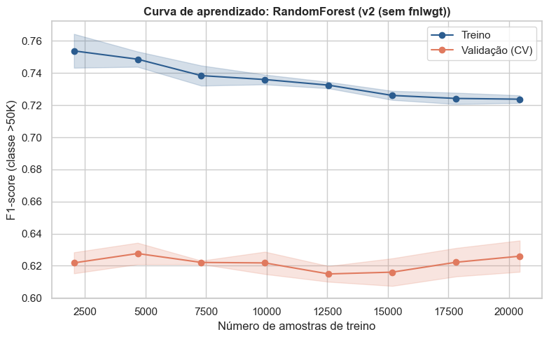

# 1. Seleção e implementação dos modelos

## 1.0 Pipeline de pré-processamento (v1 = o da APS1)

Mesmas decisões da APS1: `fnlwgt` com `log1p` + padronização; `age` e `education.num` padronizadas; categóricas com imputação pela categoria explícita `"Missing"` e one-hot (`handle_unknown="ignore"`). O pré-processador é colocado **dentro** do `Pipeline` com o modelo, assim, na validação cruzada, ele é re-ajustado só com o fold de treino (sem *data leakage*).

??? example "Ver código"

    ```python
    cat_features = ["workclass", "marital.status", "occupation", "relationship", "race", "sex", "native.country"]

    def build_preprocessor(usar_fnlwgt=True):
        # Constrói o pré-processador. usar_fnlwgt=False gera a variante v2 (Seção 1.3).
        fnlwgt_pipe = Pipeline([
            ("log", FunctionTransformer(np.log1p, feature_names_out="one-to-one")),
            ("scaler", StandardScaler()),
        ])
        cat_pipe = Pipeline([
            ("imputer", SimpleImputer(strategy="constant", fill_value="Missing")),
            ("onehot", OneHotEncoder(handle_unknown="ignore")),
        ])
        transformers = [("num", Pipeline([("scaler", StandardScaler())]), ["age", "education.num"]),
                        ("cat", cat_pipe, cat_features)]
        if usar_fnlwgt:
            transformers.insert(0, ("fnlwgt", fnlwgt_pipe, ["fnlwgt"]))
        return ColumnTransformer(transformers)

    preprocessor_v1 = build_preprocessor(usar_fnlwgt=True)
    preprocessor_v1
    ```


??? note "Estrutura do pré-processador (v1)"

    ```text
    ColumnTransformer(transformers=[('fnlwgt',
                                     Pipeline(steps=[('log',
                                                      FunctionTransformer(feature_names_out='one-to-one',
                                                                          func=<ufunc 'log1p'>)),
                                                     ('scaler', StandardScaler())]),
                                     ['fnlwgt']),
                                    ('num',
                                     Pipeline(steps=[('scaler', StandardScaler())]),
                                     ['age', 'education.num']),
                                    ('cat',
                                     Pipeline(steps=[('imputer',
                                                      SimpleImputer(fill_value='Missing',
                                                                    strategy='constant')),
                                                     ('onehot',
                                                      OneHotEncoder(handle_unknown='ignore'))]),
                                     ['workclass', 'marital.status', 'occupation',
                                      'relationship', 'race', 'sex',
                                      'native.country'])])
    ```


## 1.1 Três modelos distintos (hiperparâmetros padrão)

- **Dummy** (`most_frequent`): sempre prevê a classe majoritária. É o piso: qualquer modelo real precisa superá-lo.
- **Regressão Logística** (modelo linear com regularização L2 por padrão): coeficientes interpretáveis, rápida, e a regularização controla overfitting.
- **Random Forest** (**ensemble de árvores**): captura interações e não-linearidades (por exemplo, `estado civil × idade × escolaridade`) sem precisar de escala.

??? example "Ver código"

    ```python
    modelos_base = {
        "Dummy": DummyClassifier(strategy="most_frequent"),
        "LogReg": LogisticRegression(max_iter=2000),
        "RandomForest": RandomForestClassifier(random_state=RANDOM_STATE, n_jobs=-1),
    }

    linhas = []
    for nome, m in modelos_base.items():
        pipe = Pipeline([("prep", preprocessor_v1), ("model", m)])
        s = cross_val_score(pipe, X_train_proc, y_tr, cv=cv, scoring=SCORING)
        linhas.append({"Modelo": nome, "F1 (média CV)": s.mean(), "Desvio": s.std()})

    tabela_base = pd.DataFrame(linhas).round(4)
    tabela_base
    ```


|    | Modelo       | F1 (média CV)   | Desvio   |
|:---|:-------------|:----------------|:---------|
| 0  | Dummy        | 0.0000          | 0.0000   |
| 1  | LogReg       | 0.6179          | 0.0075   |
| 2  | RandomForest | 0.6052          | 0.0057   |


**Análise:**

- **Dummy:** F1 = 0 em todos os folds, pois sempre prevê `<=50K` e nunca acerta um `>50K`. Sua *accuracy* seria ≈ 0,76 (proporção da classe majoritária), o que reforça por que a accuracy não serve como métrica aqui.
- **LogReg e RandomForest:** desempenhos próximos (F1 = 0,6179 vs. 0,6052); ambos superam o Dummy com folga e variam pouco entre folds (σ ≈ 0,006–0,008). Com diferença de ~1 desvio-padrão, não se pode afirmar superioridade de um dos dois sem um teste pareado (feito na Seção 1.3).

## 1.2 Seleção de hiperparâmetros

- **Regressão Logística** → `GridSearchCV` (espaço pequeno): `C` (inverso da força da regularização; menor `C` significa mais regularização) e `penalty` (L1 zera coeficientes, L2 os encolhe).
- **Random Forest** → `RandomizedSearchCV` (espaço maior, amostrado): `n_estimators`, `max_depth`, `min_samples_leaf` e `max_features`. Limitar a profundidade e exigir mais amostras por folha reduz o overfitting.

??? example "Ver código"

    ```python
    def make_search(kind, preprocessor):
        # Cria a busca de hiperparâmetros para 'LogReg' ou 'RandomForest' com o pré-processador dado.
        if kind == "LogReg":
            pipe = Pipeline([("prep", preprocessor),
                             ("model", LogisticRegression(solver="liblinear", max_iter=2000))])
            grid = {"model__C": [0.01, 0.1, 1, 10, 100], "model__penalty": ["l1", "l2"]}
            return GridSearchCV(pipe, grid, cv=cv, scoring=SCORING, n_jobs=-1)
        pipe = Pipeline([("prep", preprocessor),
                         ("model", RandomForestClassifier(random_state=RANDOM_STATE, n_jobs=-1))])
        dist = {"model__n_estimators": [100, 200, 300],
                "model__max_depth": [5, 8, 12, 20, None],
                "model__min_samples_leaf": [1, 3, 5, 10, 20],
                "model__max_features": ["sqrt", "log2", 0.3]}
        return RandomizedSearchCV(pipe, dist, n_iter=12, cv=cv, scoring=SCORING,
                                  n_jobs=-1, random_state=RANDOM_STATE)

    gs_lr = make_search("LogReg", preprocessor_v1).fit(X_train_proc, y_tr)
    rs_rf = make_search("RandomForest", preprocessor_v1).fit(X_train_proc, y_tr)

    print("LogReg      | melhor F1 (CV):", round(gs_lr.best_score_, 4), "|", gs_lr.best_params_)
    print("RandomForest| melhor F1 (CV):", round(rs_rf.best_score_, 4), "|", rs_rf.best_params_)
    ```


```text
LogReg      | melhor F1 (CV): 0.6184 | {'model__C': 1, 'model__penalty': 'l2'}
RandomForest| melhor F1 (CV): 0.6252 | {'model__n_estimators': 200, 'model__min_samples_leaf': 3, 'model__max_features': 0.3, 'model__max_depth': None}
```

??? example "Ver código"

    ```python
    resultados_v1 = {"LogReg": gs_lr, "RandomForest": rs_rf}
    melhor_nome = max(resultados_v1, key=lambda k: resultados_v1[k].best_score_)

    tabela_1 = pd.concat([
        tabela_base.set_index("Modelo")["F1 (média CV)"].rename("Padrão"),
        pd.Series({"Dummy": tabela_base.loc[0, "F1 (média CV)"],
                   "LogReg": gs_lr.best_score_, "RandomForest": rs_rf.best_score_}, name="Otimizado"),
    ], axis=1).round(4)
    display(tabela_1)
    print("Melhor modelo até aqui:", melhor_nome)
    ```


|              | Padrão   | Otimizado   |
|:-------------|:---------|:------------|
| Dummy        | 0.0000   | 0.0000      |
| LogReg       | 0.6179   | 0.6184      |
| RandomForest | 0.6052   | 0.6252      |


```text
Melhor modelo até aqui: RandomForest
```

??? example "Ver código"

    ```python
    # Melhores configurações de cada busca: mostra se há um platô de desempenho (robustez da escolha)
    def top_configs(busca, n=5):
        r = pd.DataFrame(busca.cv_results_)
        cols = [c for c in r.columns if c.startswith("param_")] + ["mean_test_score", "std_test_score", "rank_test_score"]
        return r.sort_values("rank_test_score")[cols].head(n).round(4)

    print("LogReg (GridSearchCV) - top 5"); display(top_configs(gs_lr))
    print("RandomForest (RandomizedSearchCV) - top 5"); display(top_configs(rs_rf))
    ```


```text
LogReg (GridSearchCV) - top 5
```

|    | param_model__C   | param_model__penalty   | mean_test_score   | std_test_score   | rank_test_score   |
|:---|:-----------------|:-----------------------|:------------------|:-----------------|:------------------|
| 5  | 1                | l2                     | 0.6184            | 0.0071           | 1                 |
| 4  | 1                | l1                     | 0.6173            | 0.0074           | 2                 |
| 6  | 10               | l1                     | 0.6173            | 0.0074           | 3                 |
| 7  | 10               | l2                     | 0.6173            | 0.0074           | 4                 |
| 8  | 100              | l1                     | 0.6172            | 0.0073           | 5                 |


```text
RandomForest (RandomizedSearchCV) - top 5
```

|    | param_model__n_estimators   | param_model__min_samples_leaf   | param_model__max_features   | param_model__max_depth   | mean_test_score   | std_test_score   | rank_test_score   |
|:---|:----------------------------|:--------------------------------|:----------------------------|:-------------------------|:------------------|:-----------------|:------------------|
| 5  | 200                         | 3                               | 0.3                         | None                     | 0.6252            | 0.0057           | 1                 |
| 9  | 200                         | 10                              | 0.3                         | 20                       | 0.6219            | 0.0032           | 2                 |
| 8  | 200                         | 20                              | 0.3                         | 20                       | 0.6186            | 0.0061           | 3                 |
| 2  | 100                         | 1                               | 0.3                         | 12                       | 0.6156            | 0.0114           | 4                 |
| 1  | 200                         | 3                               | sqrt                        | None                     | 0.6120            | 0.0047           | 5                 |


**Análise do ajuste de hiperparâmetros (Padrão vs. Otimizado):**

- **Dummy:** permanece em F1 = 0; é apenas o piso de comparação.
- **Regressão Logística (GridSearchCV, 10 combinações):** 0,6179 → 0,6184 (+0,05 p.p.). Os melhores `C = 1` e `penalty = 'l2'` coincidem com o padrão; a pequena diferença vem da troca de solver (`lbfgs` → `liblinear`). Ganho desprezível: com estas features o modelo linear já está perto do seu teto.
- **Random Forest (RandomizedSearchCV, 12 de 225 combinações):** 0,6052 → 0,6252 (+2,0 p.p.), ganho bem maior que o desvio entre folds (≈ 0,006), portanto provavelmente real. Melhor configuração: `n_estimators=200`, `max_depth=None`, `min_samples_leaf=3`, `max_features=0.3`.
- **Cautela na interpretação:** como a busca amostrou só 12 combinações, não é possível atribuir o ganho a um único hiperparâmetro. Leitura plausível (hipótese, não resultado isolado): `min_samples_leaf=3` reduz a variância das folhas; `max_features=0.3` (≈ 26 colunas, contra ≈ 9 do `sqrt` num espaço de ~89 colunas após o one-hot) aumenta a diversidade entre as árvores; `max_depth=None` deixa capturar interações. A tabela das melhores configurações (célula acima) permite checar a robustez: se configurações vizinhas têm F1 parecido, o resultado não depende de um ajuste fino.
- **Comparação entre modelos:** a RF otimizada (0,6252) fica 0,7 p.p. acima da LogReg (0,6184), cerca de 1 desvio-padrão. Adotamos a RF como melhor modelo por ter o maior F1 médio e maior capacidade de capturar não-linearidades, mas a vantagem é modesta; a Seção 1.3 a verifica de forma pareada.

## 1.3 Mudança no pipeline: remover `fnlwgt` (pipeline v2)

**Proposta:** retirar `fnlwgt` do conjunto de features.

**Justificativa:** baseado na EDA da APS1, vimos que `fnlwgt` é um peso amostral do censo (quantas pessoas da população cada linha representa), **não** uma característica do indivíduo. Na análise bivariada (`fnlwgt × workclass`) ele pouco diferenciou os grupos, e na análise numérica não teve relação com `income`. Mantê-lo pode acrescentar ruído e dar ao modelo uma variável sem sentido causal ou preditivo.

**Hipótese:** o desempenho se mantém ou melhora levemente, com um modelo mais simples. Para isolar o efeito, mudamos somente isso e refazemos a seleção de hiperparâmetros do melhor modelo, com a mesma métrica e a mesma validação.

??? example "Ver código"

    ```python
    preprocessor_v2 = build_preprocessor(usar_fnlwgt=False)

    busca_v2 = make_search(melhor_nome, preprocessor_v2).fit(X_train_proc, y_tr)

    comparacao = pd.DataFrame({
        "Pipeline": ["v1 (com fnlwgt)", "v2 (sem fnlwgt)"],
        "Modelo": [melhor_nome, melhor_nome],
        "F1 (média CV)": [resultados_v1[melhor_nome].best_score_, busca_v2.best_score_],
    }).round(4)
    display(comparacao)
    print("Hiperparâmetros v2:", busca_v2.best_params_)
    ```


|    | Pipeline        | Modelo       | F1 (média CV)   |
|:---|:----------------|:-------------|:----------------|
| 0  | v1 (com fnlwgt) | RandomForest | 0.6252          |
| 1  | v2 (sem fnlwgt) | RandomForest | 0.6262          |


```text
Hiperparâmetros v2: {'model__n_estimators': 200, 'model__min_samples_leaf': 3, 'model__max_features': 0.3, 'model__max_depth': None}
```

??? example "Ver código"

    ```python
    # Escolha do modelo final: só adotamos a v2 se ela de fato melhorou o F1 de validação
    if busca_v2.best_score_ > resultados_v1[melhor_nome].best_score_:
        busca_final, versao_final = busca_v2, "v2 (sem fnlwgt)"
    else:
        busca_final, versao_final = resultados_v1[melhor_nome], "v1 (com fnlwgt)"

    modelo_final = busca_final.best_estimator_
    print(f"Modelo final: {melhor_nome} | pipeline {versao_final} | F1 CV = {busca_final.best_score_:.4f}")
    ```


```text
Modelo final: RandomForest | pipeline v2 (sem fnlwgt) | F1 CV = 0.6262
```

??? example "Ver código"

    ```python
    # Comparação pareada fold a fold (mesmos folds `cv`): a diferença é maior que o ruído entre folds?
    def comparar(nome_a, est_a, nome_b, est_b):
        sa = cross_val_score(est_a, X_train_proc, y_tr, cv=cv, scoring=SCORING)
        sb = cross_val_score(est_b, X_train_proc, y_tr, cv=cv, scoring=SCORING)
        d = sb - sa
        print(f"{nome_b} - {nome_a}: diferença média = {d.mean():+.4f} | desvio das diferenças = {d.std():.4f} "
              f"| folds em que {nome_b} >= {nome_a}: {(d >= 0).sum()}/{len(d)}")
        print("  ->", "diferença dentro do ruído entre folds (modelos equivalentes)" if abs(d.mean()) < d.std()
              else "diferença maior que o ruído entre folds")
        return pd.DataFrame({nome_a: sa, nome_b: sb}).round(4)

    # (a) Efeito da mudança de pipeline: v1 vs v2 (RF otimizada)
    display(comparar("RF v1", resultados_v1[melhor_nome].best_estimator_, "RF v2", busca_v2.best_estimator_))
    # (b) Modelo: LogReg (v1) vs RF (v1)
    display(comparar("LogReg v1", gs_lr.best_estimator_, "RF v1", rs_rf.best_estimator_))
    ```


```text
RF v2 - RF v1: diferença média = +0.0010 | desvio das diferenças = 0.0071 | folds em que RF v2 >= RF v1: 1/5
  -> diferença dentro do ruído entre folds (modelos equivalentes)
```

|    | RF v1   | RF v2   |
|:---|:--------|:--------|
| 0  | 0.6274  | 0.6274  |
| 1  | 0.6236  | 0.6183  |
| 2  | 0.6148  | 0.6123  |
| 3  | 0.6286  | 0.6434  |
| 4  | 0.6313  | 0.6296  |


```text
RF v1 - LogReg v1: diferença média = +0.0067 | desvio das diferenças = 0.0054 | folds em que RF v1 >= LogReg v1: 4/5
  -> diferença maior que o ruído entre folds
```

|    | LogReg v1   | RF v1   |
|:---|:------------|:--------|
| 0  | 0.6137      | 0.6274  |
| 1  | 0.6251      | 0.6236  |
| 2  | 0.6085      | 0.6148  |
| 3  | 0.6172      | 0.6286  |
| 4  | 0.6276      | 0.6313  |


**Análise do impacto da mudança no pipeline (v1 vs. v2):**

- **Resultado:** v1 (com `fnlwgt`) F1 = 0,6252; v2 (sem `fnlwgt`) F1 = 0,6262, diferença de +0,001. A mesma configuração de hiperparâmetros foi selecionada nas duas buscas.
- **Significância:** a comparação pareada fold a fold (célula acima) compara a diferença média com o desvio das diferenças. Como o efeito observado (0,001) é muito menor que a variação entre folds (σ ≈ 0,006), a leitura correta é **"sem perda de desempenho"**, e não "melhora".
- **Decisão:** adotamos a v2 por **parcimônia**: desempenho equivalente com um pré-processamento mais simples (sem `log1p` + padronização) e sem uma variável que não descreve o indivíduo. Isso é coerente com a EDA da APS1: `fnlwgt` é um peso amostral do censo, sem relação com `income` nem poder de separar grupos.
- **Consistência com a Seção 3.2:** o `fnlwgt` aparece como 3ª feature mais "importante" na Random Forest v1 e, ainda assim, removê-lo não prejudica o modelo. Isso é o que se espera do viés conhecido da importância por impureza para variáveis contínuas de alta cardinalidade (Strobl et al., 2007).
- **Comparação LogReg vs. RF (pareada):** a mesma célula verifica se a vantagem da RF supera o ruído entre folds.

## 1.4 Curvas de aprendizado do melhor modelo

Mostram o F1 de treino e de validação conforme o tamanho do conjunto de treino aumenta. Leitura:

- **gap grande** entre treino e validação → overfitting (variância alta);
- **ambas baixas e próximas** → underfitting (viés alto);
- **validação já estabilizada** → mais dados provavelmente trariam pouco ganho.

??? example "Ver código"

    ```python
    tamanhos, tr_sc, va_sc = learning_curve(
        modelo_final, X_train_proc, y_tr, cv=cv, scoring=SCORING,
        train_sizes=np.linspace(0.1, 1.0, 8), n_jobs=-1, random_state=RANDOM_STATE
    )

    plt.figure(figsize=(8, 5))
    for sc, nome, cor in [(tr_sc, "Treino", "#2b5c8f"), (va_sc, "Validação (CV)", "#e07a5f")]:
        plt.plot(tamanhos, sc.mean(axis=1), "o-", label=nome, color=cor)
        plt.fill_between(tamanhos, sc.mean(axis=1) - sc.std(axis=1),
                         sc.mean(axis=1) + sc.std(axis=1), alpha=0.2, color=cor)
    plt.title(f"Curva de aprendizado: {melhor_nome} ({versao_final})", fontweight="bold")
    plt.xlabel("Número de amostras de treino")
    plt.ylabel("F1-score (classe >50K)")
    plt.legend()
    plt.tight_layout()
    plt.show()
    ```





**Análise da curva de aprendizado (Random Forest v2):**

- **Variância:** gap de ≈ 10 p.p. entre treino (≈ 0,72–0,75) e validação (≈ 0,61–0,63), que se mantém em todos os tamanhos. Indica sobreajuste moderado, esperado com `max_depth=None`; o `min_samples_leaf=3` o mantém controlado. A curva de treino cai levemente conforme há mais dados (menos memorização), mas a de validação não sobe.
- **Saturação:** o F1 de validação é praticamente plano desde as menores amostras (~2.000) até ~20.000, oscilando dentro da faixa de ruído (±0,01). Mais dados do mesmo tipo trariam pouco ganho: o gargalo é a informação disponível nas features, não o volume.
- **Direções que atacariam o gargalo:** features mais informativas, outros ensembles (Gradient Boosting) e ajuste do limiar de decisão para reequilibrar precision e recall.
